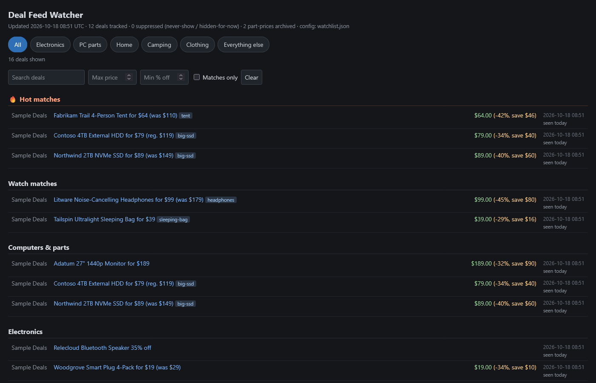

# deal-feed-watcher



A deal watcher that runs on a schedule, reads the big deal sites' feeds, and puts the deals that match the things you actually want at the top of one self-contained HTML page, with everything else sorted into categories below them. No AI is involved anywhere: matching is plain regular expressions you write, and the price math is arithmetic over what the feeds say and what the watcher has seen before.

Deal feeds carry far more offers than anyone reads, and the few you would buy get buried in the churn. Writing down what you want once and letting a script read the feeds for you catches them, and because the watcher keeps a price history, over time it can tell a real discount from a "sale" at the usual price.

## What you get

- **One page with your matches first**: hot matches (worth a notification) and watch matches (dashboard only), then per-category sections of other recent deals, with search, a max-price filter, a minimum-discount filter and a "matches only" switch that hides everything else. Categories listed in the watchlist's `matched_only_categories` show matches only. It works on a phone.
- **A discount figure even when the feed gives none.** Many feeds never state a list price. The watcher groups similar listings and compares a new price against the median of what that group has sold for. That comparison decides whether a match is hot, and `digest_feed.json` carries it with a label saying which kind of number it is (stated by the feed, or computed from history); the page itself shows only feed-stated discounts.
- **Price drops on repeat offers**, measured against the lowest price that offer has ever shown, so a listing that bounces up and down by a dollar a day does not keep coming back as news.
- **Sold-out detection for Woot** through its official API, so the page stops linking to dead deals.
- **`digest_feed.json`**, a small file of recent matches that any notifier (a chat bot, an email script) can read.
- **A computer-parts price archive**, folded monthly into `price_history.json`, for comparing part prices over months before you buy.

## Requirements

Python 3.10 or newer. Standard library only, nothing to install.

## Setup

1. Copy `sources.example.json` to `sources.json`. It lists the feeds to poll; the file's `_readme` explains each field. Woot and CamelCamelCamel ship disabled because they need something from you:
   - **Woot:** request a key through the Woot developer program, put it alone in `woot_api_key.txt`, and set `"enabled": true`.
   - **CamelCamelCamel:** your account's price-alert feed address is private, so it goes alone in `ccc_feed_url.txt`, never in `sources.json`.
2. Copy `watchlist.example.json` to `watchlist.json` and add your entries. Each entry is a name, a tier, and the patterns that identify the thing; the `_readme` in the file lists every field.
3. Run it once by hand to check: `python deal_watcher.py`. It logs each source to `watcher.log` and writes `dashboard.html` and `digest_feed.json` next to itself.
4. Schedule it a few times a day with Task Scheduler, cron or launchd.

To show the page somewhere, set `DEAL_WATCHER_DASHBOARD` to a path inside a folder a web server already serves. Never serve this folder itself: it holds your API key and alert feed address.

## Usage

```
python deal_watcher.py                 # poll every enabled source, score, render
python deal_watcher.py --dashboard     # re-render the page from the database, no fetching
python deal_watcher.py --rescore       # apply a watchlist edit to every stored deal
python deal_watcher.py --rebuild       # re-extract prices and rebuild the price baselines
python deal_watcher.py --consolidate   # fold last month's part prices into price_history.json
python deal_watcher.py --tuning-stats  # write tuning_stats.json: which entries still match, what each filter hides
```

`--rescore` is the one to run after editing the watchlist. `--rebuild` is only needed when the pricing or baseline code changes. `--tuning-stats` is there for a periodic review of the watchlist: it shows entries that have gone quiet, what each hiding pattern is eating, and the unmatched deals the page still shows.

## Known limits

- Retail product pages behind Cloudflare's bot wall cannot be price-checked from a script, so the watcher reads feeds only. A store with no feed is out of reach.
- A deal that drops out of a feed is not proof it ended (feeds rotate), so older matches move to an "older listings" section instead of disappearing. Only Woot can be checked for real.
- The BradsDeals source reads that site's HTML. If the site is redesigned, that source logs 0 items until the pattern is updated; it never crashes the run.

## Tests

```
python -m unittest discover -s tests
```

The tests run offline, including one full run against a local sample feed.

## Lessons

[lessons/what-the-feeds-taught.md](lessons/what-the-feeds-taught.md) covers what went wrong while building this and what replaced it.

## License

MIT
